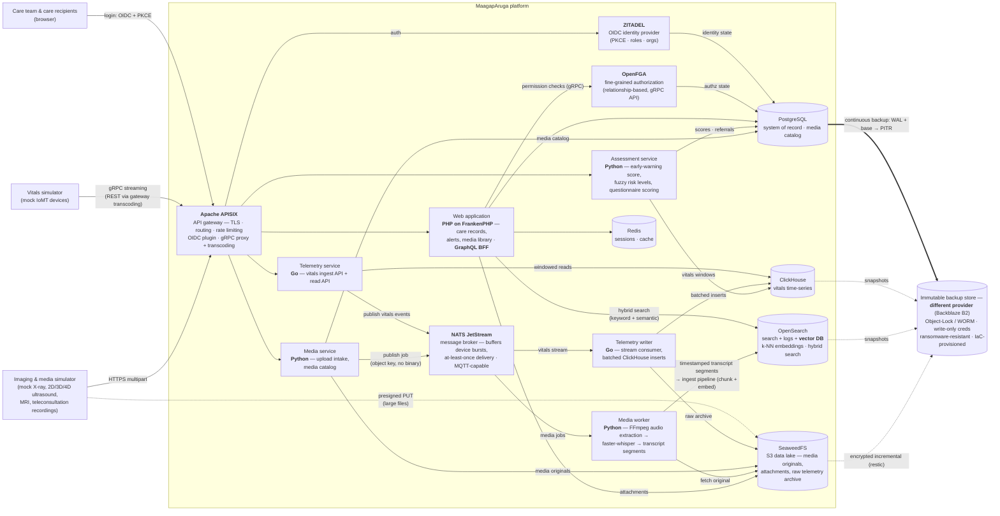
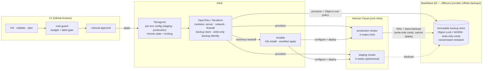
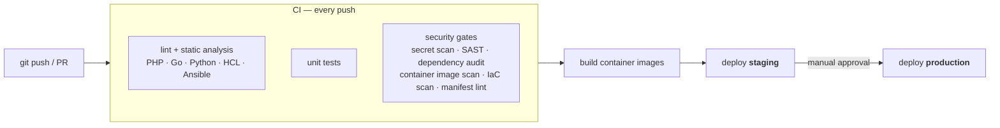
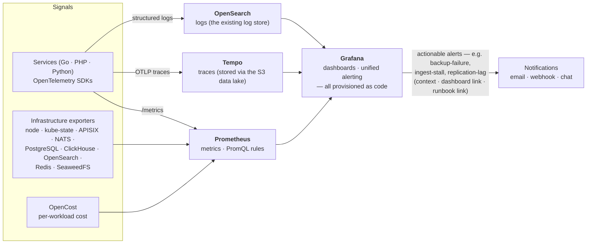

# MaagapAruga

[](LICENSE)

> **Maagap** (Filipino: *prompt, timely, proactive*) + **Aruga** (Filipino: *nurturing, compassionate care*).
> MaagapAruga — **proactive, compassionate care**: an open-source research and educational
> care-platform framework covering telemedicine records, biotelemetry ingest, and
> assessment scoring for care teams.

## Intended use

**MaagapAruga is a research and educational software framework.** It is **not a medical
device**, is not CE-marked, and is **not intended for the diagnosis, treatment, monitoring,
or prevention of disease in real patients**. It ships exclusively with **fictitious mock
data** and must not be used with real personal or health data. Anyone deploying this
software in a clinical or care context does so as the responsible manufacturer/operator
under applicable law (including EU MDR 2017/745 and GDPR) and must perform their own
conformity assessment. See [DISCLAIMER.md](DISCLAIMER.md).

The framework itself is **engineered to production standards and genuinely deployable** —
real high-availability infrastructure, real security controls, real data handling. The *data* it
ships with is fictitious mock data; the *platform* is not. That engineering quality is
exactly why the line above matters: *because* the software is capable of running a real
care workload, the legal and regulatory responsibility for any such deployment —
certification, conformity assessment, data protection — rests entirely with the deployer,
never with this project or its authors.

## What it is

A **complete, production-grade, deployable platform** — one repository containing the
application code *and* the infrastructure that runs it:

| Component | Technology | Purpose |
|---|---|---|
| `gateway` | **Apache APISIX** | API gateway & single entry point — TLS, routing, rate limiting (standalone mode, YAML-driven) |
| `apps/web` | **PHP on FrankenPHP** (Laravel + Octane) | Web application — care records, questionnaires, alerts, media library; **GraphQL BFF** (Lighthouse) aggregating records + vitals + scores + media search into single dashboard queries. FrankenPHP (Go application server) also allows selected PHP functions to be implemented natively in Go |
| identity & access | **ZITADEL + OpenFGA** | OIDC login with PKCE (browser + device clients) enforced at the gateway; relationship-based fine-grained permissions (*which* caregiver may see *which* care recipient) checked over OpenFGA's gRPC API |
| `services/telemetry` | **Go** | Vitals/biotelemetry ingest + read API (heart rate, SpO₂, blood pressure, temperature, …) — **gRPC-first** (protobuf, streaming ingest), exposed as REST too via APISIX gRPC transcoding |
| `services/assessment` | **Python** | Scoring service — early-warning scores, fuzzy-logic risk levels, questionnaire scoring |
| `services/media` | **Python** | Media pipeline — intake of (mock) imaging & audio/video uploads (X-ray, 2D/3D/4D ultrasound, MRI, teleconsultation recordings); worker transcribes with Whisper (via faster-whisper) and feeds embeddings for semantic search |
| message broker | **NATS JetStream** | Decouples device ingest from processing — buffers fleet-scale bursts, at-least-once job delivery; messages carry object keys, never binaries (claim-check pattern) |
| observability | **Prometheus · Grafana · Tempo + OpenTelemetry** | Metrics, cross-language traces, and log views in one Grafana pane; **actionable alerting** (context + dashboard + runbook links) provisioned as code — see [Observability](#observability--actionable-alerting) |
| `deploy/k8s` | **Kubernetes (Kustomize)** | Base manifests + per-environment overlays — minikube locally, k3s on the cloud VMs |
| `infra` | **Terragrunt + OpenTofu/Terraform, Ansible** | Provision Hetzner Cloud environments, install k3s, apply the stack |
| data layer | **PostgreSQL · ClickHouse · OpenSearch · Redis · SeaweedFS** | Right store per workload — see [Data layer](#data-layer) |

**Care-team roles modeled:** administrator, doctor, nurse, medical transcriptionist,
care provider (for elderly, sick, terminally ill, and autistic individuals), and the
patient / care recipient. All seeded personas are **clearly fictitious**.

## The decided stack at a glance

Each row is backed by an [Architecture Decision Record](docs/adr/README.md) that names
the alternatives considered and why they lost.

| Concern | Decision | In one line, why |
|---|---|---|
| Runtime platform | **Kubernetes everywhere** — minikube (dev), k3s (cloud) | Identical manifests in every environment; only overlay variables differ |
| API gateway | **Apache APISIX** | The most complete OSS gateway today: OIDC plugin, native gRPC proxy + transcoding, rate limiting, TLS |
| Identity / authorization | **ZITADEL** (OIDC + PKCE) / **OpenFGA** (relationship-based) | Standards-based login enforced at the gateway; "who may see which care recipient" as data, not code |
| Web application | **Laravel + Octane on FrankenPHP** | Productive, mature, widely deployed product framework; worker mode plus selected PHP functions implemented in Go |
| Services | **Go** telemetry (gRPC-first) · **Python** assessment · **Python** media | Each language where it's strongest: throughput, scientific scoring, ML/media tooling |
| API styles | **REST + gRPC + GraphQL (BFF)** | Each where it earns its place — see [Three API styles](#architecture) |
| Message broker | **NATS JetStream** | Decouples device ingest from processing; tiny footprint; MQTT-capable; claim-check + batching patterns |
| Data stores | **PostgreSQL** (CloudNativePG) · **ClickHouse** · **OpenSearch 3.x** (search + logs + **vector DB**) · **Redis** · **SeaweedFS** | One clearly justified job per store; no extra vector database needed |
| Media ML | **faster-whisper** (speech-to-text) · **sentence-transformers** (embeddings, app-side) | CPU-efficient models, memory bounded by pod limits — fits small VMs |
| Observability | **OpenTelemetry → Prometheus · Tempo · OpenSearch → Grafana** unified alerting | Metrics, traces, logs, cost in one pane; actionable alerts provisioned as code |
| IaC | **Terragrunt + OpenTofu/Terraform + Ansible** on Hetzner | Modular multi-env HCL, remote state + locking, pipeline-validated |
| Environments | dev (minikube) · **staging: 3-node, ephemeral** · **production: 3-node HA** | Staging mirrors production (a real rehearsal), kept cheap by being ephemeral; production has no single-VM SPOF; domain is a variable |
| CI/CD | **GitHub Actions** — DevSecOps gates + FinOps cost gate | Security scanning and budget enforcement block merges, not humans-remembering |
| Versions | **Latest stable, pinned exactly**, auto-refreshed | Current functionality (e.g. OpenSearch 3.x vector pipeline) without floating tags |

## Why this architecture

Three principles drove every choice:

1. **One clearly justified tool per concern.** Nothing is here because it's fashionable;
   everything is here because a competing option was weighed and lost — Kong, Kafka,
   Redpanda, Loki, Keycloak, a dedicated vector database, and a service mesh were all
   considered and rejected for reasons this repository states explicitly: every
   significant decision is an **Architecture Decision Record** in
   [`docs/adr/`](docs/adr/README.md), with the rejected options, the reasoning, and the
   conditions that would reopen the decision. The same discipline applies per language:
   Go where throughput matters, Python where the ML ecosystem lives, PHP where product
   velocity matters.
2. **Right-sized, not toy-sized.** This is real, production-grade software — a 3-node HA
   cluster, not a hyperscale fleet, but built to genuine standards: broker-decoupled
   ingest with backpressure, claim-check messaging, batched writes, an external identity
   provider, fail-closed fine-grained authorization, distributed tracing across three
   languages, and clustered data stores with quorum across separate machines. Nothing is
   faked; it is simply sized for a single-region deployment rather than planetary scale.
3. **Scale honesty.** This architecture is a genuinely deployable care platform sized for
   single-region use. If the ambition were **billions of data points from devices
   serving billions of people**, the *patterns* would survive but
   the *choices* would need to adapt: many-node clusters and sharding rather than a
   3-node quorum, Kafka-class streaming in place of a single-binary broker,
   sharded and geo-distributed storage, edge ingest, managed services where they win,
   GPU inference — and whatever better technology exists by then. The seams are designed
   for that evolution: everything speaks open interfaces (S3 API, OIDC, protobuf
   contracts, SQL, OpenTelemetry), node counts are variables, and every component can be
   replaced without rewriting its neighbors. An architecture is a set of decisions with
   reasons, and reasons get re-evaluated when the requirements change.

**Microservices, not a monolith — and honest failure domains.** The monorepo holds
**independently built, deployed, and scaled services** that share no code and no
in-process calls — they communicate only through APIs (REST/protobuf/GraphQL) and the
message broker, and all of them are stateless, with state confined to the data layer.
By construction there is **no architectural single point of failure**: every component
is either replicable (services, gateway, workers) or clusterable (PostgreSQL
primary + replica with automated failover, ClickHouse ×3, OpenSearch ×3, NATS
clustering, SeaweedFS replication). **Production deploys that shape** — a 3-node cluster
where anti-affinity keeps replicas on separate machines, so losing a node degrades the
platform without taking it down. The single-node footprint is confined to **local dev**
(minikube), where there is nothing to protect; staging mirrors production's 3 nodes
precisely because it is a deploy rehearsal. Scaling further is a change of node count and
replica count — with zero service-code changes ([ADR 0014](docs/adr/0014-microservices-failure-domains.md)).

Throughout, two disciplines are treated as first-class, not afterthoughts:
**DevSecOps** — security gates (secrets, SAST, dependency, container, IaC scanning) block
every push, least privilege by construction, a human gate before production — and
**FinOps** — a budget guardrail that fails the pipeline on overspend, ephemeral staging,
right-sized workloads, and per-workload cost visibility next to the performance
dashboards. See [DevSecOps workflows](#devsecops-workflows) and
[FinOps](#finops--caring-about-infrastructure-cost).

## Architecture



Everything runs on **Kubernetes**: [minikube](https://minikube.sigs.k8s.io/) on the
developer machine, [k3s](https://k3s.io/) (lightweight Kubernetes) across the cloud
cluster nodes — the same Kustomize manifests with per-environment overlays.

**Ingest at device-fleet scale.** IoT/IoMT ingest is **decoupled from processing by a
message broker** ([NATS JetStream](https://docs.nats.io/nats-concepts/jetstream)): the
intake APIs do the minimum (validate, persist the binary, publish a small event) and
return immediately, while stream consumers process at their own pace. A burst from a
large device fleet therefore queues up in the broker instead of overwhelming the
services — and throughput scales by adding consumers, not by redesigning. Two rules keep
this honest: messages carry **references, never binaries** (the claim-check pattern —
originals go straight to the S3 store, jobs carry the object key), and ClickHouse is written by
a **batching consumer** rather than per-request inserts, which is exactly how ClickHouse
wants to be fed. JetStream gives at-least-once delivery with durable consumers, and NATS
natively speaks **MQTT**, the protocol real device fleets typically use.

**Media & semantic search pipeline.** Care settings produce more than numeric vitals:
imaging devices (X-ray, 2D/3D/4D ultrasound, MRI) and recorded tele-consultations emit
images, audio, and video. The media service accepts those uploads (all **synthetic mock
media** in this project), stores the originals in the object store, keeps a metadata catalog in
PostgreSQL, and publishes a processing job to the broker. The media worker consumes the
job, extracts audio with FFmpeg, transcribes it with
[faster-whisper](https://github.com/SYSTRAN/faster-whisper) (CTranslate2 Whisper —
several times faster than reference Whisper with int8 quantization on CPU, which is what
small VMs have), and produces **timestamped transcript segments**. Those segments flow
into an OpenSearch ingest pipeline that chunks the text and generates embeddings, indexed
as `knn_vector` fields — so OpenSearch doubles as the platform's **vector database**.
Search from the web app is **hybrid**: BM25 keyword matching + semantic k-NN + metadata
filters, and every hit links back to the exact timestamp in the original media file.

**Identity & authorization.** Authentication is delegated to **ZITADEL** (OIDC with
PKCE) — APISIX's `openid-connect` plugin enforces it at the gateway, the Laravel app
consumes it via Socialite, and native/device clients use the standard Authorization Code
+ PKCE flow. *Coarse* roles (doctor, nurse, transcriptionist, …) come from ZITADEL
claims; *fine-grained* permissions — "may caregiver A view care recipient B's media?" —
are modeled as relationships in **OpenFGA** and checked by the services over its gRPC
API. Both keep their state in PostgreSQL.

**Three API styles, each where it earns its place:**

| Style | Where | Why there |
|---|---|---|
| **REST/JSON** | Public application APIs (web, assessment, media) through APISIX | The lingua franca — right default for browser and integration clients |
| **gRPC** | Device → telemetry vitals ingest (protobuf contract, client streaming); OpenFGA permission checks from the services | Compact binary encoding + streaming suit high-frequency device telemetry; APISIX proxies gRPC natively and its `grpc-transcode` plugin serves the **same telemetry service as REST** — one implementation, two surfaces |
| **GraphQL** | The web app's BFF endpoint (Laravel Lighthouse) | Aggregation across polyglot services is GraphQL's home turf: one dashboard query returns care record (PostgreSQL) + latest vitals window (telemetry gRPC) + risk score (assessment) + media search hits (OpenSearch hybrid) |

**Component versions.** Every component tracks its **latest stable release** — pinned to
exact versions in the manifests (no floating `latest` tags) and kept current by automated
dependency updates. This matters functionally, not just hygienically: e.g. the vector
pipeline relies on the current OpenSearch 3.x generation (ingest-time chunking/embedding,
neural + hybrid search), which older branches don't provide.

The design follows one principle end to end: **detect early, assess continuously, refer
promptly** — which is exactly what *maagap* means.

## Data layer

Each store has one clearly justified job:

| Store | Role | Cluster support |
|---|---|---|
| **PostgreSQL** | Transactional system of record: care records, questionnaires, referrals, media catalog; also hosts ZITADEL (identity) and OpenFGA (authorization) state | managed by the **CloudNativePG** operator — **primary + streaming replica with automated failover** in production (single instance in local dev) |
| **ClickHouse** | High-volume vitals/biotelemetry time-series and analytics | node count is a variable — **3-node cluster (+ 3× ClickHouse Keeper)** in production (single node in local dev) |
| **OpenSearch** | Full-text search over transcriptions and care notes; **vector database** (`knn_vector` embeddings over transcript segments, ingest-pipeline chunking + embedding, hybrid BM25 + semantic queries); centralized application logs | node count is a variable — **3-node cluster** in production (single node in local dev) |
| **Redis** | Sessions, caching, rate-limit counters, and the web app's internal task queue (Laravel queues — app-local "do this later" commands; anything crossing a service boundary goes through NATS instead) | single node |
| **SeaweedFS** | S3-compatible object storage ("data lake"): media originals (mock imaging/audio/video), record attachments, raw telemetry archive. Chosen when MinIO's community edition was discontinued ([ADR 0015](docs/adr/0015-seaweedfs-object-storage.md)) — a swap that proved the S3 seam: no service code changed | single node (all-in-one `weed server`) — **swappable for any S3-compatible service** by changing endpoint + credentials only; scales out via split roles, replication, erasure coding, and transparent cloud tiering |
| **NATS JetStream** | Ingest buffer & job queue: vitals event stream, media processing jobs — decouples intake from processing, absorbs device-fleet bursts | clustered in production; Kafka/Redpanda is the documented scale-out path if stream volume ever outgrows it |

Local dev runs everything single-node on minikube; **production runs the clustered
shape** — OpenSearch ×3, ClickHouse ×3 with a 3-node Keeper quorum, PostgreSQL
primary + replica under CloudNativePG — and staging mirrors it. Node counts are
variables, so the same manifests scale further.

One rule governs how those nodes are placed: **each cluster node gets its own VM.**
Replicas colocated on a single machine would share the same disk IO, memory bandwidth,
and CPUs — the exact resources that are the bottleneck — adding *topology* (quorum,
replication, failover mechanics) but **no capacity and no fault isolation**. So the
cluster is multi-node Kubernetes across separate VMs on a private network, with **pod
anti-affinity** ensuring no two replicas of the same store
ever share a host; the IaC keeps VM count as the same variable as node count.

Deliberately, **no separate vector database is added**: current OpenSearch (3.x) already
provides k-NN vector indexing, ingest-time chunking/embedding, and hybrid lexical+semantic
search, so vectors live next to the text they index. (Redis 8's vector search was
evaluated as the alternative; keeping Redis focused on sessions/cache preserves the
one-clear-job-per-store principle.)

## Resilience — backups & disaster recovery

Data that cannot be restored is not protected, and for a care platform the threat model
includes **ransomware — which targets backups first.** So recoverability is a design
concern here, not an afterthought. Full strategy:
**[deploy/k8s/DISASTER-RECOVERY.md](deploy/k8s/DISASTER-RECOVERY.md).**

**Layered by data class** — a live database is not a pile of files, so each class uses
the right tool:

| Data | How it is protected |
|---|---|
| **PostgreSQL** (system of record) | CloudNativePG continuous backup: base backups **+ continuous WAL archiving** to S3 → **point-in-time recovery** to any second (the WAL *is* the incremental). Daily scheduled base backup + retention. **Restore is verified, not assumed** — a drill recovers a throwaway cluster and checks the row counts match. |
| **Object storage / files** | `restic` → incremental, deduplicated, **client-side encrypted**, append-only repository |
| **ClickHouse / OpenSearch** | engine-native snapshots to S3 (largely re-derivable from Postgres + objects, so snapshotted mainly to shorten recovery time) |

**Ransomware resistance**, in priority order: **immutable / Object-Lock (WORM)** backup
storage, so a backup cannot be altered or deleted before its retention expires *even
with stolen admin credentials* — the single most important control; **separate,
write-only backup credentials** (the platform can *write* a backup but cannot *delete*
one, so a compromised cluster cannot wipe its own restore points); client-side
encryption; **a different provider** for the offsite copy — **Backblaze B2** (chosen
because it is a separate provider from the Hetzner core *and* supports Object-Lock;
DigitalOcean Spaces was considered for the separation but has no Object Lock), so a
compromise or outage of the primary cloud account can't take the platform *and* its
backups at once (the 3-2-1-1-0 rule); MFA-delete or an air-gapped pull; and a
**backup-failure alert** so a missing backup pages you instead of surprising you at
restore time. Recovery is always into a *new* cluster — the corrupted volume is left
intact for forensics.

**This is where Infrastructure as Code earns its place.** These controls are not
application config — they are *infrastructure*: the immutable, off-cluster object store,
its Object-Lock / lifecycle policy, and the split write-only backup identity are
**provisioned and version-controlled by the IaC** per environment, so disaster recovery
is reproducible and auditable rather than a manual runbook someone hopes was followed.
Local dev backs up to the in-cluster object store to prove the *mechanism*; the cloud
overlays repoint it at **Backblaze B2 — a different provider from the Hetzner core** —
for real, off-provider, immutable DR. (Backup provider is an IaC choice, decoupled from
where the core infra runs.)

## Repository layout

```
maagaparuga/
├── gateway/apisix/            # APISIX standalone config: routes, TLS, plugins
├── apps/web/                  # PHP web application
├── services/telemetry/        # Go vitals ingest (gRPC streaming + transcoded REST) + read API
├── services/assessment/       # Python scoring service
├── services/media/            # Python media pipeline: intake → S3 store → NATS job → faster-whisper → vectors
├── proto/                     # shared protobuf contracts (telemetry gRPC)
├── data/mock/                 # fictitious seed personas & sample vitals (the ONLY data)
├── deploy/k8s/
│   ├── base/                  # Kustomize base: all Deployments/StatefulSets/Services
│   └── overlays/              # dev (minikube) · staging · production (k3s)
├── infra/
│   ├── terragrunt/
│   │   ├── staging/           # staging environment (ephemeral, ~8 GB VM)
│   │   └── production/        # production environment (~16 GB VM)
│   ├── modules/               # OpenTofu/Terraform modules: server, network, firewall
│   └── ansible/               # roles: base hardening, k3s install, stack deploy
├── docs/
│   ├── adr/                   # Architecture Decision Records (options, rejections, reasoning)
│   └── runbooks/              # alert runbooks (linked from Grafana alerts)
├── DISCLAIMER.md  NOTICE  SECURITY.md  LICENSE
```

## Environments

| Environment | Where | Kubernetes | Provisioned by |
|---|---|---|---|
| **dev** | local machine | minikube (single node) | — (`kubectl apply -k deploy/k8s/overlays/dev`) |
| **staging** | Hetzner Cloud, **3-node cluster**, **ephemeral** — created for a rehearsal, destroyed after | k3s (multi-node) | Terragrunt + OpenTofu/Terraform → Ansible |
| **production** | Hetzner Cloud, **3-node HA cluster**, always on | k3s (multi-node) | Terragrunt + OpenTofu/Terraform → Ansible |

**Staging is a full rehearsal of production, so it is the same *shape* — the same node
count and the same manifests.** A single-node staging could not rehearse the things that
only exist across nodes (pod anti-affinity actually separating replicas, cross-node
networking, store quorum, rolling updates that move workloads between hosts), so it
mirrors production's 3-node topology exactly. What keeps it cheap is **ephemerality, not
shrinking it**: Hetzner bills hourly, so a 3-node staging that lives for the ~hour of a
deploy rehearsal and is then destroyed costs a few VM-hours while remaining a true mirror.

**Production runs a 3-node cluster** so there is **no single-VM point of failure**:
losing a node degrades the platform but does not take it down. Stateless services run
with replicas spread across nodes by anti-affinity; the store clusters (PostgreSQL
primary + replica, ClickHouse ×3, OpenSearch ×3) get real quorum across separate
machines. Node count is a variable, so the same manifests scale further; dev stays
single-node minikube (it develops code, it does not rehearse a deploy — the multi-node
cluster overlay is available locally when you want to exercise the clustered shape).

**Domain scheme.** One **base domain**, supplied as a single Terragrunt variable — the
name itself is whatever you own (`whatever.de`, `example.org`, …), nothing is hard-coded.
Production serves at the apex (`<base-domain>`), staging at `staging.<base-domain>`, and
one Let's Encrypt **wildcard certificate** (`*.<base-domain>`, issued via DNS-01) covers
both — terminated at APISIX. DNS-01 is deliberate: ephemeral staging recreates its
environment often enough that per-hostname HTTP-01 issuance would hit Let's Encrypt's
duplicate-certificate rate limits.

## Infrastructure as Code

Provisioning uses **Terragrunt** on top of **OpenTofu/Terraform**. The infrastructure code
is standard HCL: **OpenTofu is a drop-in, Terraform-compatible engine, so the same modules
run unchanged with either `tofu` or `terraform`** — the two are interchangeable here.
Configuration management and application deployment use **Ansible**.



Disaster recovery is part of the provisioned infrastructure, not a bolt-on: the IaC
stands up the **immutable, off-node backup store** (Object-Lock/WORM) and a **write-only
backup identity** — so a compromised cluster can *write* a backup but can never *delete*
one. See [Resilience](#resilience--backups--disaster-recovery) for the recovery model.

IaC conventions in this repository:

- **Modular, multi-environment layout** — reusable modules under `infra/modules/`,
  one thin Terragrunt configuration per environment under `infra/terragrunt/` (the
  classic `modules/` + `live/` pattern), so environments differ by variables, not by
  copy-pasted HCL.
- **Remote state with locking** per environment — no `*.tfstate` in the repository,
  ever.
- **Pipeline-validated** — every change runs `fmt` → `validate` → `plan` (plus the
  FinOps cost gate) in CI; `apply` happens only behind the manual-approval gate.
- **Secrets hygiene** — no credentials, SSH keys, certificates, or secret-bearing
  `terraform.tfvars` committed; committed examples use the `*.tfvars.example`
  convention, real values live in gitignored files / GitHub environment secrets.
- **Least exposure at the edge** — cloud VMs (Ubuntu LTS) are firewalled with
  **Hetzner Cloud Firewalls, default-deny inbound**: only 80/443 (the APISIX
  gateway) are world-reachable; SSH is restricted to an admin IP allow-list
  supplied per environment (never committed); the Kubernetes API stays closed
  (SSH tunnel access). Data stores, broker, and identity services are never
  exposed publicly — each environment gets its **own dedicated Hetzner private
  network** (distinct address ranges per environment), Kubernetes binds to the
  private interface, and all system-internal traffic stays on it; the public
  interface exists solely for the gateway and allow-listed SSH.
- **Disaster recovery is provisioned, not improvised** — the **off-provider** backup
  store (Backblaze B2, a different provider from the Hetzner core), its **Object-Lock /
  immutability + lifecycle** policy, and the **write-only backup identity** (can write a
  backup, cannot delete one) are all IaC, per environment. The backup provider is
  decoupled from the core-infra provider — a deliberate "don't keep the platform and its
  backups in one basket" split. That is what makes the ransomware-resistant,
  restore-tested recovery under [Resilience](#resilience--backups--disaster-recovery)
  reproducible and auditable instead of a manual runbook.
- **Readable on purpose** — generously commented, beginner-followable HCL: the modules
  double as documentation of the platform's shape.

Planned flow per environment:

```bash
cd infra/terragrunt/staging
terragrunt apply           # provision cluster nodes + network + firewall (tofu or terraform)
terragrunt output -raw ansible_inventory > ../../ansible/inventories/staging/hosts.yml
cd ../../ansible
ansible-playbook -i inventories/staging playbooks/site.yml   # k3s + stack deploy
```

## DevSecOps workflows

Security is a pipeline stage, not an afterthought — every push runs the full gauntlet:



- **Shift-left gates:** secret scanning over full history, SAST per language, dependency
  audits, container image scanning, IaC scanning (OpenTofu/Terraform modules), and
  Kubernetes manifest linting — all blocking, all on every push.
- **Least privilege by construction:** no long-lived cloud credentials in CI beyond what a
  deploy needs; secrets live in environment-scoped stores, never in the repository.
- **Human gate to production:** staging deploys automatically; production always requires
  a manual approval.

## Observability & actionable alerting

Metrics, traces, and logs all land in **Grafana** as the single pane — for the platform
infrastructure and for the system itself. *(Current state: Prometheus + Grafana unified
alerting are deployed, with the backup-failure alert live and provisioned as code; the
OpenTelemetry tracing path, Tempo, and the full exporter set are the next slice of this
tier. The design below is the target.)*



- **Prometheus** is the metrics engine (scraping the services plus native exporters for
  every store, NATS, APISIX, node and kube-state); **Grafana unified alerting** is where
  alerts are defined, grouped, and routed — dashboards *and* alert rules live in the
  repository as provisioned YAML, not as hand-clicked UI state.
- **Traces span the polyglot chain**: one request can be followed from APISIX through
  the PHP BFF, a gRPC call into the Go telemetry service, and a Python scoring call —
  OpenTelemetry SDKs in all three languages, Tempo (single-binary, object storage on
  SeaweedFS) as the backend.
- **No Loki**: logs already have a home in OpenSearch; Grafana queries it directly via
  its OpenSearch data source. One log store, one clearly justified job.
- **Actionable means actionable**: every alert carries current vs. normal values, the
  affected service/endpoint, a link to the relevant dashboard, and a runbook link —
  alerts a responder can act on without archaeology. Representative catalog:
  - **backup failure / stale recovery point** — a base backup failed or the recovery
    point stopped advancing, i.e. the disaster-recovery safety net itself is degraded
    (see [Resilience](#resilience--backups--disaster-recovery)); ransomware makes this a
    top-priority page, not a nice-to-have
  - vitals ingestion stalls (no events consumed for N minutes — the platform's core
    *maagap* promise)
  - NATS JetStream consumer lag / backlog growth beyond threshold
  - media (transcription) worker failure rate or repeated job redeliveries
  - PostgreSQL replication lag (CloudNativePG), ClickHouse & OpenSearch disk headroom
  - API p95 latency above target, elevated 5xx rate at the gateway
  - failed-login spikes at ZITADEL (from logs — an audit signal, not just an ops one)
- **FinOps ties in here too:** OpenCost metrics feed a Grafana cost dashboard, so
  spend-per-namespace sits next to CPU and latency rather than in a separate tool.

## FinOps — caring about infrastructure cost

Cost is treated as a first-class operational signal, right-sized to the actual load:

- **Bounded footprint:** production is a fixed 3-node cluster (no autoscaling surprises),
  and staging exists only while a rehearsal is running — so the predictable monthly cost
  is production's 3 nodes plus the occasional VM-hours staging spends being tested.
- **Ephemeral staging:** Hetzner bills hourly, so staging is provisioned on demand
  (`terragrunt apply`), used to rehearse the production deploy, then destroyed
  (`terragrunt destroy`). You pay for staging only while it is actually testing something.
- **Right-sizing everywhere:** every Kubernetes workload declares resource requests and
  limits; store memory (OpenSearch heap, ClickHouse caps) is tuned to the VM size instead
  of defaulting to more hardware.
- **Automated cost guardrail in the pipeline (Operate):**
  [`tools/cost-guard`](tools/cost-guard/README.md) prices every OpenTofu/Terraform plan
  against [`infra/budget.json`](infra/budget.json) and **fails the pipeline** when the
  projected monthly cost exceeds the environment's budget or when a plan reaches for a
  server type outside the allow-list. (Infracost, the usual CI cost-diff tool, prices
  AWS/Azure/GCP only — Hetzner needs this repo's own guard.)
- **Price visibility (Inform):** `cost-guard refresh` snapshots live Hetzner prices from
  the cloud API into a committed file, so budget checks run deterministically in CI with
  no cloud credentials; every check prints a per-resource monthly cost table.
- **Cost attribution by construction:** every cloud resource must carry `environment` and
  `project` labels — enforced by the guardrail, not by convention. Planned on top:
  [OpenCost](https://www.opencost.io/) (CNCF) in the k3s cluster with a custom pricing
  model, attributing cost per namespace and workload.
- **Documented cheaper paths:** SeaweedFS can be swapped for a managed S3-compatible object
  storage, and any component can move to a larger/smaller VM class — trade-offs are
  documented rather than hard-coded.

## Status

Active development. In place: the infrastructure baseline, the web application (browser
login via OIDC), and the telemetry service (device authentication + per-care-recipient
authorization). The assessment and media services are next. Operational groundwork lands
alongside the services rather than after — liveness/startup probes across the workloads,
PostgreSQL continuous backup to object storage with a **verified** restore, a
backup-failure alert (Prometheus + Grafana unified alerting), and gateway edge
authentication on the API routes. Production runs as a 3-node HA cluster with staging
mirroring it as an ephemeral rehearsal (see [Environments](#environments)); larger
deployments are a change of node count, not a rewrite.

## Research lineage

MaagapAruga is inspired by a line of systems in the same domain going back to **2007**.
It is an **independently developed**, modern open-source platform built on a new 2026
codebase: no source code, datasets, documentation text, media assets, or other
copyright-protected material from those systems is included in this repository.

| Year | System | Historical influence |
|---|---|---|
| **2007** | **TMIS** — Telemedicine Management Information System | The foundation: care-team role model and structured telemedicine records |
| 2021–2022 | Successive prototypes (Python, then Go) | Vitals ingest from IoT devices, per-vital APIs, early-warning-score concepts |
| **2023** | **SEDS** — Stress and Emotion Detection System | IoMT ingest → fuzzy-logic risk levels → automatic referral; questionnaire-based assessment |
| **2024** | **BTMS** — Biotelemetry and Telemedicine System | Biotelemetry breadth: NEWS2 early-warning scoring, DASS21 questionnaires, anthropometric profiles |
| **2026** | **MaagapAruga** (this repository) | Independent open-source implementation: new codebase, modern architecture, mock data only |

This repository reflects the historical evolution of the underlying research across
TMIS, the subsequent prototypes, SEDS, and BTMS. MaagapAruga is an independent
implementation written in 2026 using a new codebase.

The projects listed above are referenced solely to document the historical evolution
of the underlying research. MaagapAruga is an independently developed open-source
software project: it contains newly written source code and uses only mock data.
Reference to earlier research does **not** imply endorsement, affiliation,
collaboration, sponsorship, or responsibility by any researcher, clinician,
institution, or funding organization associated with those projects. See
[DISCLAIMER.md](DISCLAIMER.md).

## Security

See [SECURITY.md](SECURITY.md) for private vulnerability reporting.

## License

[Apache License 2.0](LICENSE) — Copyright (c) 2026 Marco Montesines and contributors.
Provided **"AS IS"**, without warranties or conditions of any kind; see
[DISCLAIMER.md](DISCLAIMER.md) and [NOTICE](NOTICE).
